# Word Tierlister: developer guide

How the code fits together, where things live, and how to test, build and release it. The user-facing
introduction is the [README](README.md).

**Contents:** [Quick start](#quick-start) · [The big picture](#the-big-picture) ·
[Import layers](#import-layers) · [Start-up](#start-up) · [A key press](#a-key-press) ·
[The life of a word](#the-life-of-a-word) · [The save file](#the-save-file) · [Threads](#threads) ·
[Builds, releases and updates](#builds-releases-and-updates) · [Find your way](#find-your-way) ·
[Options](#options) · [Folders](#folders) · [Files](#files) · [Notes beside the code](#notes-beside-the-code) ·
[Where to change things](#where-to-change-things) · [Tests](#tests) · [Reference](#reference)

## Quick start

```sh
pip install -r requirements.txt      # wordfreq (required), nltk (optional: offline definitions, WordNet)
python tierlist.py --db test.db      # a throwaway save; --help lists every option
sh tests/run_tests.sh                # every self-test (KEEP_GOING=1 lists all failures)
python tools/check_release.py --tests   # the checks to pass before handing work over
```

tkinter ships with Python (Debian / Ubuntu: `sudo apt install python3-tk`). Window tests need a display; on a
headless Linux box they run under `xvfb-run` by themselves. The roadmap (every step, its status and the decisions
behind it) is the big comment block at the top of `tierlist.py`; `.claude/CLAUDE.md` holds the conventions.

## The big picture

`tierlist.py` starts everything. The save is a single SQLite file, and **`Store` is the only thing that touches
it**: every public `Store` method that changes something commits before it returns, so the program can be killed
at any moment without losing an answer. The main window (`App`) never keeps state of its own that matters: after
each action it asks the Store again and redraws (`App.refresh`).

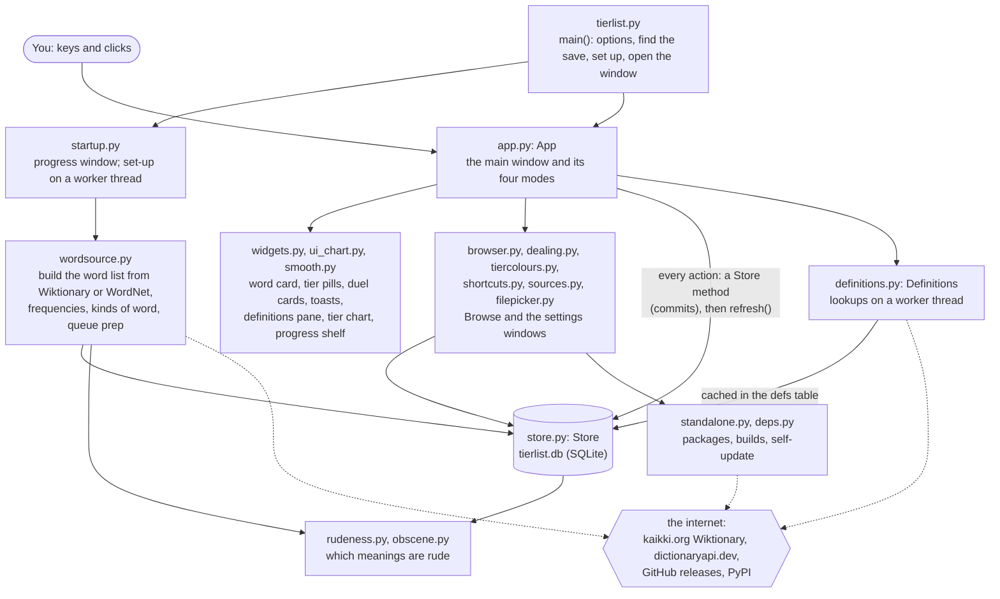

## Import layers

A file only imports from files in earlier layers. `tools/check_release.py` enforces it (`LAYERS`), so the arrows
below can only point down. Only the UI layers import tkinter; `problems.py`, `deps.py` and everything else in the
bottom layer work without it. Each box lists the modules of one layer, and the arrows show what each layer really
imports (worked out from the code).

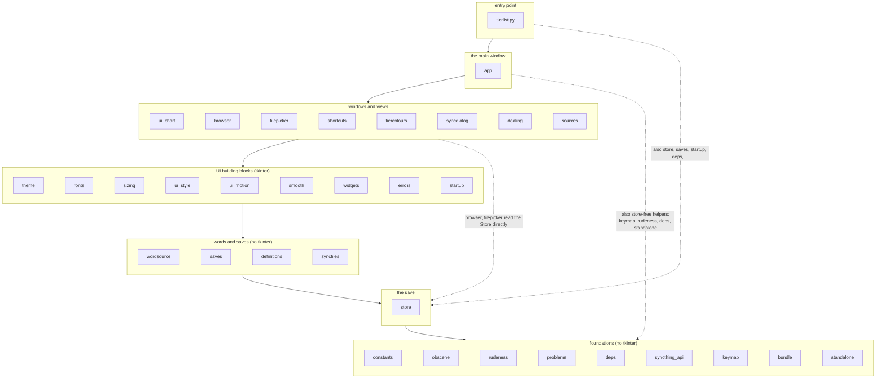

Who uses whom, module by module (from the imports; `python tools/notes.py` writes the same into each file's
note):

| Module | Imports |
|---|---|
| `tierlist` | app, browser, constants, definitions, deps, errors, fonts, problems, saves, sizing, standalone, startup, store, theme, ui_style, wordsource |
| `app` | browser, constants, dealing, definitions, deps, errors, filepicker, fonts, keymap, rudeness, saves, shortcuts, sizing, sources, standalone, syncdialog, theme, tiercolours, ui_chart, ui_motion, ui_style, widgets, wordsource |
| `sources` | constants, deps, errors, filepicker, fonts, problems, saves, standalone, startup, theme, widgets |
| `syncdialog` | deps, errors, fonts, problems, saves, startup, syncfiles, syncthing_api, theme, widgets |
| `browser` | constants, errors, fonts, keymap, sizing, smooth, store, theme, ui_motion, widgets |
| `filepicker` | errors, fonts, saves, store, theme, widgets |
| `dealing` | constants, fonts, obscene, rudeness, theme, widgets |
| `tiercolours` | constants, fonts, smooth, theme, ui_motion, widgets |
| `shortcuts` | fonts, keymap, sizing, theme, widgets |
| `ui_chart` | constants, smooth, theme, ui_motion |
| `widgets` | constants, definitions, fonts, rudeness, sizing, smooth, theme, ui_motion |
| `startup` | constants, deps, errors, fonts, problems, sizing, syncthing_api, theme |
| `errors` | constants, fonts, problems, theme, ui_style, widgets |
| `ui_style` | fonts, theme |
| `smooth` | fonts |
| `wordsource` | constants, obscene, problems, rudeness |
| `saves`, `definitions` | constants |
| `syncfiles` | store |
| `store` | constants, obscene, rudeness |
| `standalone` | bundle, constants, deps |
| `rudeness` | obscene |
| `deps` | constants |
| `syncthing_api` | deps |
| `constants`, `obscene`, `problems`, `keymap`, `bundle`, `theme`, `fonts`, `sizing`, `ui_motion` | nothing of ours |

## Start-up

What `tierlist.main()` does, in order. Everything from opening the save onward runs inside `errors.run_guarded`,
so any failure ends in a friendly dialog and a line in `tierlist.log` instead of a traceback.

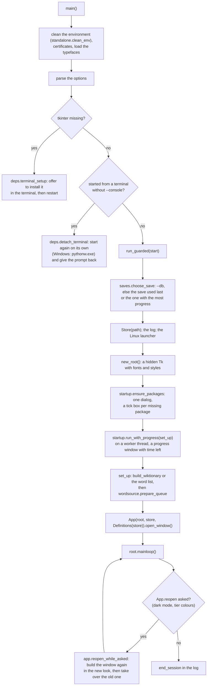

## A key press

Every key goes through `App.on_key`. Keys are never hard-coded: `keymap.py` says what a key means in the current
view, and the user can change any of them. Input never waits for an animation: running ones hurry out of the way.

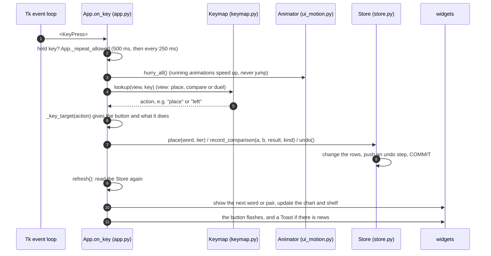

## The life of a word

A word's state is a few columns of its row in `words` (`tier`, `skips`, `out`, `rating`, `games`). The four tabs
are four ways of moving words through these states.

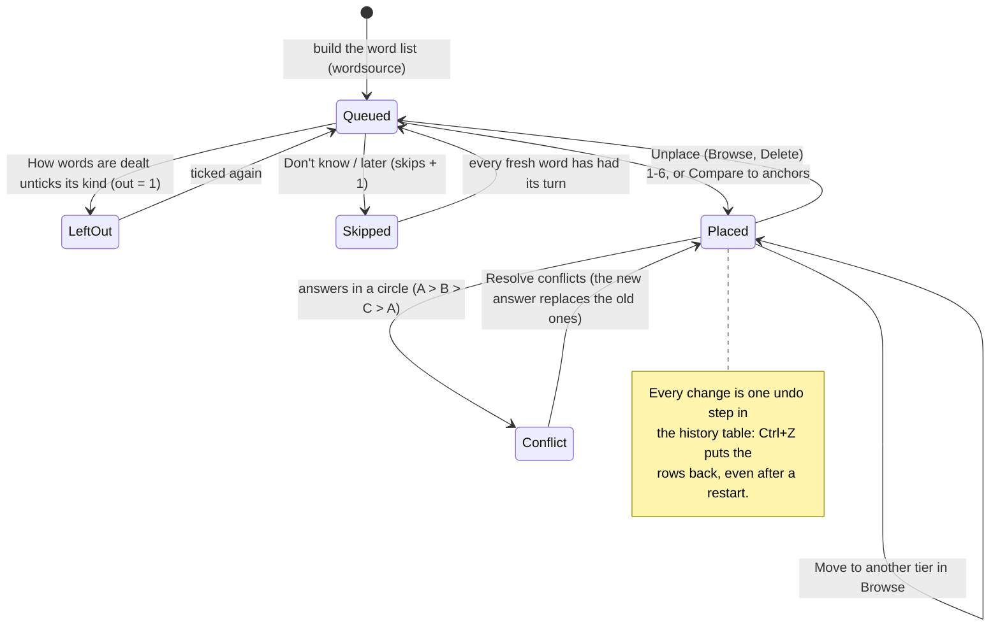

Which word comes next (`Store.next_unplaced`): fresh words first, then skipped ones, each in the seeded queue order
(`qkey`, set by `Store.reshuffle`: the odds of coming up early fall off with the frequency rank; compound words are
pushed back). Which pair comes next: `Store.pick_within` (fewest duels first, the nearest rating),
`Store.pick_boundary`, `Store.pick_conflict`.

## The save file

One SQLite file (`tierlist.db`). New indexes go in `store.WORD_INDEXES`, and writes of more than `BULK_ROWS` rows
go through `Store.bulk_write`.

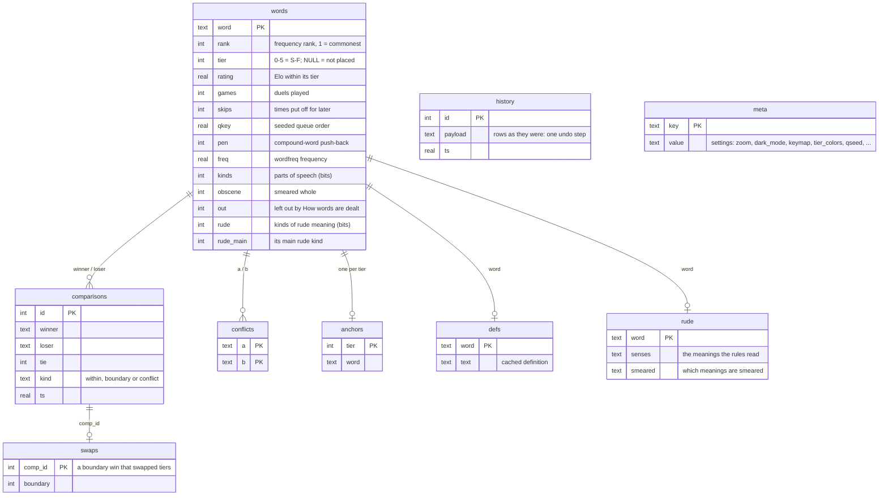

## Threads

Tk is single-threaded, so only the main thread touches widgets. Worker threads hand their results back through
queues that the main loop polls. No animation frame may touch the database.

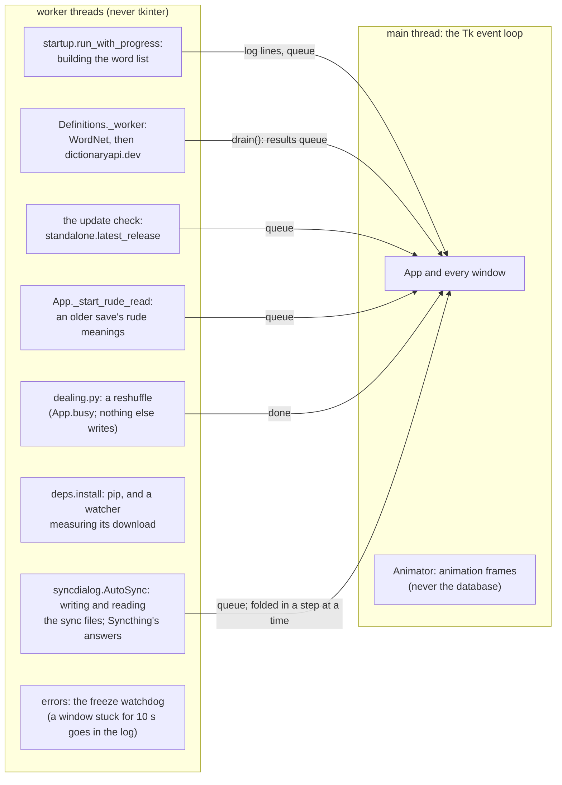

## Builds, releases and updates

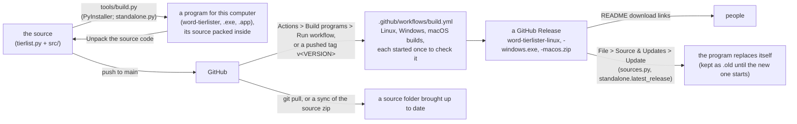

The download links in the README must keep naming the current assets (`standalone.RELEASE_ASSETS`);
`tests/_selftest_updates.py` checks them against the workflow.

Security rules to keep (from the security review, S-2..S-7): only the workflow's release job may write to the
repository (`contents: write` there alone); a downloaded source zip is written entry by entry through
`standalone.inside`, never straight out; a linked Syncthing device never gets `autoAcceptFolders`; a CSV export's
words go through `constants.csv_cell` (no spreadsheet formulas) and come back through `csv_word`. An update is
trusted because it comes from this repository's releases over checked HTTPS: keep two-factor sign-in on the
GitHub account that publishes them. Each release also carries `SHA256SUMS.txt` and a build attestation per program
(S-1) for people to check by hand.

**Checking a download.** Each release carries `SHA256SUMS.txt`, the SHA-256 sums of the three programs
(`sha256sum word-tierlister-linux`, `certutil -hashfile word-tierlister-windows.exe SHA256` on Windows,
`shasum -a 256 word-tierlister-macos.zip` on a Mac). GitHub also signs a record of where each program was built
(`actions/attest-build-provenance` in the release job): with the [GitHub CLI](https://cli.github.com/),
`gh attestation verify word-tierlister-linux --repo kiva-mccr/Word-Tierlister` says whether that exact file was built
by this repository's workflow.

## Find your way

| You want to change... | Start in |
|---|---|
| A ranking rule: duels, Elo, undo, the queue, conflicts, merging saves | `src/store.py` |
| What a key or button does, what shows on screen | `src/app.py` (`on_key`, `_key_target`, `_show_place`, `_show_pair`) |
| A key's default | `src/keymap.py` (`ACTIONS`) |
| The menus | `App._menu_items` in `src/app.py` |
| How a widget looks or animates | `src/widgets.py` (and its test, `tests/_selftest_widgets2.py`) |
| Colours | `src/theme.py` (`PALETTE`, `TIER_COLORS`, the dark look `DARK`, `contrast()`) |
| Fonts and text sizes | `src/fonts.py` (`font(role)`) |
| Window sizes, zoom, fitting the screen | `src/sizing.py`, `App._worst_size`, `App._fit_window`, `App._fill_pane`, `App.set_zoom` |
| Rounded shapes and icons | `src/smooth.py` (`SmoothCanvas.round_rect`, `icon_image`) |
| The tier chart and the progress shelf | `src/ui_chart.py` |
| The word list: download, parsing, frequencies | `src/wordsource.py` |
| What counts as rude | `src/rudeness.py` (bump `RUDENESS_VERSION`), `src/obscene.py` |
| Definitions | `src/definitions.py` |
| An error's wording | `src/problems.py` (`describe`) |
| Packages and their install dialog | `src/deps.py`, `src/startup.py` |
| Syncing between devices | `src/syncfiles.py`, `src/syncthing_api.py`, `src/syncdialog.py`, `Store.apply_sync` |
| Builds, updates, unpacking the source | `src/standalone.py`, `src/sources.py`, `tools/build.py`, `.github/workflows/build.yml` |

The more detailed list is [Where to change things](#where-to-change-things), and every code file has a note
beside it with its rules and pitfalls: read `src/app.md` before editing `src/app.py`.

## Options

All optional; `python tierlist.py --help` explains each.

| Option | What it does |
|---|---|
| `--db FILE` | Use this save. Without it, the save you used last (or the one with the most progress) is found by itself. |
| `--wordlist FILE` | Start a new save from your own list, one word per line, in that order. |
| `--source wiktionary` / `wordnet` | Where a new save's words come from: all of English Wiktionary (default, about 1M) or WordNet's ~77k base forms. |
| `--wiktionary-file FILE` | Build from a kaikki.org English download you already have (`.jsonl` or `.jsonl.gz`). |
| `--include-phrases` | Also take multi-word entries such as "ice cream" (Wiktionary). |
| `--keep-download` | Keep the 3 GB Wiktionary download after building. |
| `--seed N` | Reshuffle the words you haven't placed yet with this seed. |
| `--console` | Keep the terminal / console attached and print to it (troubleshooting). |
| `--no-install` | Never offer to install missing packages, nor (on the first start) to make a program or unpack the source. |

## Folders

```
tierlist.py        run this. Your save (tierlist.db), its log and exports stay next to it.
requirements.txt   the Python packages (the program offers to install them itself)
src/               the program's modules; src/icons/ holds its icon (drawn by tools/make_icon.py), src/typefaces/
                   its two fonts (fetched by tools/make_typefaces.py)
tests/             the self-tests and run_tests.sh
tools/             check_release.py (pre-hand-off checks, builds the zip), layout_trace.py (layout jitter finder),
                   build.py + hooks/ (build it as a program), measure_rudeness.py (measures the rudeness rules),
                   make_icon.py (draws the icon), make_typefaces.py (fetches the fonts), speed_check.py and
                   stress_ui.py (speed and stress checks), notes.py (keeps the notes beside the code current)
.claude/           notes for Claude Code: CLAUDE.md (project notes) and CHECKLIST.md
.github/           the build and macOS test workflows, the release notes
docs/images/       the README's screenshots
README.md          the user-facing introduction; DEVELOPERS.md is this guide
```

`tierlist.py` stays at the top on purpose: the save is found "next to the script", so moving or
replacing the other folders never loses your list. A built program (File > Source & Updates, or `tools/build.py`) keeps it next to
the program instead, or, if that folder is read-only, in your user data folder (`%APPDATA%\Word Tierlister`,
`~/.local/share/word-tierlister`). A Mac app always keeps it in `~/Library/Application Support/Word Tierlister`
and unpacks its source into `~/Documents/Word Tierlister source` (F-47: nothing of its own beside it in
Applications; a save an older version kept beside the .app is still found). Either way the save you used last is
found again, so switching between the two loses nothing.

## Files

| File | Job |
|---|---|
| `tierlist.py` | Entry point: command-line options, start-up sequence, `main()`. Also holds the roadmap. |
| `src/constants.py` | The program's VERSION and GitHub repository (T-8), tier names, modes, ranking defaults, the kinds of words (ST-6) and the masked text of a censored word. No dependencies. |
| `src/obscene.py` | The kinds of rude meaning (Clinical, Crude, Swear word, Insult, Sexual, Slur), which start ticked and which are censored; Wiktionary's rude labels; a short list chosen by hand (the stand-in until a save has Wiktionary's meanings, and for a word added by hand). No tkinter, no internet. |
| `src/rudeness.py` | How rude each meaning is, by rules, no word list (OB-6): points towards each kind (Clinical, Crude, Swear word, Insult, Sexual, Slur) from Wiktionary's labels, its topics and categories, the definition's wording, the word itself and, when nltk's WordNet is installed, the matching WordNet meaning's place in its tree and its usage labels; a second pass over Wiktionary's synonym lists says which kind a slang meaning is; a meaning's kind; the word's points, its first meaning counting most (enough of them: the whole word smeared); word families (a word built from a rude one: its etymology, or that word's derived terms) add a little; what a word's scores lead to (`score_saved`: the kinds of its meanings, smeared whole, the meanings smeared); how the program keeps meanings compactly (`compact_entry`, `expand`, `has_signal`). No tkinter, no internet. |
| `src/keymap.py` | The keyboard shortcuts (UI-48): every action with a key, its view and default keys, your changes on top (saved in the save); key presses to key names. No tkinter. |
| `src/store.py` | `Store`: the SQLite save. Tiers, anchors (they follow their tier), Elo duels, undo, queue order, which words are dealt (kinds of word and of rude meaning, the ones left out; ST-6, OB-5), the meanings the rudeness rules read and what they found (OB-6), conflicts, boundary swaps, the progress shelf's tallies, merging. |
| `src/wordsource.py` | Building the word list (WordNet, Wiktionary; each word's parts of speech), compound detection, word frequencies (for the coverage tag), kinds for an older save (from its definitions), the meanings the rudeness rules read (`RudeCollector`, kept at the Wiktionary build; `fetch_rude_senses` for an older save, in the background) and scoring them (`find_rude`), queue prep. |
| `src/saves.py` | Where the save lives (`app_dir`: tierlist.py's folder, or a built program's own, T-1); finding / remembering your earlier save; export. |
| `.github/workflows/build.yml` | Build programs (T-8, T-16): builds the Linux, Windows and macOS (Apple Silicon) programs on GitHub (a button, or `tools/build.py --all`); a pushed tag `v<VERSION>` publishes them as a release. |
| `.github/workflows/macos.yml` | Test on macOS (T-18): on GitHub's Macs (Apple Silicon and Intel), runs every self-test (split over 2 machines for Apple Silicon and 3 for Intel, run at once: `SHARD=k/n`, `tests/_shard.py`), builds the program and starts it, and keeps screenshots of each stage and the built app as downloads of the run. Runs on pull requests that touch the code, never for a change only to `.md` files, docs or images (a newer push cancels the older run), pushes to main, and the Run workflow button. |
| `.github/workflows/tests.yml` | Test on Linux and Windows (T-20): every self-test on GitHub's Linux (under xvfb and openbox, 2 machines) and Windows (3 machines), run at once, with the build test making and starting the program. Runs on pull requests that touch the code, never for a change only to `.md` files, docs or images (a newer push cancels the older run), pushes to main, and the Run workflow button. |
| `.github/release-notes.md` | The short note at the top of every release's page (T-5): the programs are unsigned, so Windows may warn (More info > Run anyway) and Linux needs the download made runnable. |
| `src/definitions.py` | Background definition lookup (WordNet offline, dictionaryapi.dev online); splitting it into senses; the word a meaning only names ("Alternative spelling of jail": `form_target`), whose first meaning the panes show under it. |
| `src/theme.py` | The two looks (light, and Dusk for dark mode, UI-77), each with its default tier colours; Browse's softer row tints, and `contrast()` (text about 7:1, UI-76). |
| `src/fonts.py` | Typography (UI-73): loads the two bundled typefaces for this program only (never installed) and builds the named size roles: Young Serif for the words, Atkinson Hyperlegible for the rest, the text in three sizes (20 / 12 / 10 pt). |
| `src/typefaces/` | Young Serif and Atkinson Hyperlegible (regular, bold, both italics), from Google Fonts under the SIL Open Font Licence (the licences beside them), with their line spacing tightened by `tools/make_typefaces.py`; `overhang.json`, the letters whose ink reaches past their box. |
| `src/ui_style.py` | ttk / tk styling (applies the palette and fonts to every widget; draws the tick boxes); puts the program's icon on every window (IC-1). |
| `src/icons/` | The icon (IC-1): the progress shelf's six spines in the tier colours on a cream tile with a slightly darker border (IC-4), the lilac mark over C. PNGs from 16 to 1024 px (windows, taskbar, the Linux launcher) and `icon.ico` (the Windows program's own icon). |
| `src/deps.py` | Packages: finds missing ones and installs them (measuring the download for a real speed and time left); the terminal stage, the private `.venv`; each package's size, purpose and web page; giving the terminal back and the applications-menu launcher (ST-5) (no tkinter). |
| `src/problems.py` | Plain-language error text (`describe`), `SetupError`, log helpers. No tkinter. |
| `src/errors.py` | Friendly error dialog, plain messages and question dialogs (all on `StyledDialog`; tick-box choices can link to a web page), global error handlers, `run_guarded` (the whole program runs inside it). |
| `src/sizing.py` | Screen/dpi-aware window sizing: usable area (xrandr on X11), `fit_size`, centring, dialog placement. |
| `src/ui_motion.py` | Easing, colour blending and the `Animator` (animations run on the Tk event loop). |
| `src/startup.py` | First-run progress window (set-up on a worker thread; time left, "Step i of n") and the window's package install step. |
| `src/smooth.py` | Smooth (anti-aliased) rounded shapes and curves for the canvases: drawn as small images, since Tk's own canvas shapes have jagged edges (worst on Windows); text whose letters reach past their boxes (Young Serif's j and f) is repainted whole (F-32). |
| `src/widgets.py` | `Tooltip` (hover notes), `RoundButton` (rounded pastel buttons with hover, press and key hints), `WordCard` (the big word on its card; its magnifier looks up any word to sort it now, typed on the card with a blinking caret; a censored word is smeared sideways, never past its own ends (F-33), its end letters smeared further inward (F-43), and un-smears under the pointer, `smear_items` / `Unsmear`), `TierRow` (the S..F pills), `TierChip` (a tier label drawn like a pill), `DuelCards` (the two duel cards with Tie / Skip), `AnchorLadder` (the S..F strip while comparing), the header pieces (`TabBar` mode tabs, which show only once they have work, `HeaderMenus` + `DropMenu`), `ChoiceButton` (drop-down choices), `Toast` (messages), `EmptyCard` (friendly "nothing to do" panels), `ShapeCard` (a queue shape and its curve, in How words are dealt), `StyledDialog` (the shared dialog frame), `SmearToggle` (the small "abc" pill, smeared or plain, that censors a kind of rude meaning or not), `LinkButton` (a small "opens elsewhere" icon, alone or after words: the Wiktionary and GitHub links), `DefinitionDrawer` (the definitions pane, with a slim scroll bar while its meanings do not all fit (F-34): it fills the room the page leaves and eases to a new height when the view changes; under "plural of colour" or "Alternative spelling of jail", that word's own meaning), `FileList` (the file picker's list) and other small widgets. |
| `src/ui_chart.py` | Each tab's own view at the top right: the tier chart (Place new words), `SettledChart` (Refine), `ConflictCard` (Conflicts); `Bookshelf`, the progress shelf under the status line (every spine one width, UI-79; a hovered spine lifts, its neighbours less; in the duel tabs a little triangle in each word's tier colour marks the spines the two words come from). |
| `src/dealing.py` | Settings > How words are dealt... (ST-6): the order (Most common first, or a little shuffled with its shape, spread, seed), which kinds of words (a tick box each, with counts; obscene words too, with a tick box per kind of rude meaning under it, OB-5, and beside each kind a small smear button to censor it or not, OB-7, OB-8) and Censor obscene words; on the first start the same in three steps. |
| `src/shortcuts.py` | Settings > Keyboard shortcuts...: change any key (click it, press the new one), add or remove keys, swap on a clash; the 1-6 placing keys move as a set. |
| `src/tiercolours.py` | Settings > Tier colours... (UI-61, UI-80): click a tier's pill, then set its colour with the H / S / V bars or a hex code (each follows the other); a colour too dark for the tier's letter is said so and Apply waits; Reset to defaults; Apply saves them and shows them (the window is rebuilt in place). |
| `src/filepicker.py` | Import / Export file choosing on Linux (UI-42): what it found first (other saves, exports), a themed folder browser behind it; Windows and macOS keep their own dialogs. |
| `src/browser.py` | The Browse / edit window: search, Show (a tier, unplaced words, or the placed words of a kind) / Sort (or click a column heading; again to turn it round; its arrow fills as the rows load), rows in soft tier colours (a censored word reads b•••••d), Move to, Unplace (or the Delete key; Ctrl+Z undoes), definition; it opens complete and in its place, like the other windows, and remembers what it showed. |
| `src/app.py` | The main window and all four modes. |
| `tools/check_release.py` | Pre-hand-off checks (packages vs requirements, docs, tests listed, files in the right folder, each code file's notes up to date, the import layers); `--tests`, `--zip`. See `.claude/CHECKLIST.md`. |
| `tools/speed_check.py` | Times refresh, placing, duels and every Browse sort on a big throwaway save (a million words by default, dense and sparse); fails when something is more than twice its budget (F-9). |
| `tools/make_typefaces.py` | Fetches the two typefaces into `src/typefaces/` with their licences and tightens their line spacing (needs the internet and fontTools). Run it only to change the fonts. |
| `tools/make_icon.py` | Draws the icon into `src/icons/` at every size (each size from the shapes, small ones snapped to whole pixels; needs Pillow). Run it only to change the icon. |
| `tools/stress_ui.py` | Random actions on the real window (keys, tabs, resizes, Browse, dialogs, censoring) on a pretend small screen; fails on any error or a window bigger than the screen (F-9). |
| `tools/notes.py` | Keeps each code file's notes (`name.md` beside `name.py`) up to date: regenerates their uses / used by / tests / public API from the code, keeping the hand-written parts; `--check` lists what is missing or stale. |
| `src/bundle.py` | What a built program carries besides its code (T-2): wordfreq's English word lists only (1.6 of its 60 MB), langcodes' registry, nltk's VERSION; `python src/bundle.py` lists them. WordNet stays an optional download. |
| `src/standalone.py` | The program and its source (T-3, T-6, T-7): the complete source (the same list the zip ships), its manifest (a hash per file), whether the program next to tierlist.py was built from exactly this source, the PyInstaller build that carries the source inside the program, and unpacking / syncing that source into a folder (only the program's own files; edits kept as .bak); the newest release on GitHub and downloading its source (T-8). No tkinter. |
| `src/sources.py` | File > Source & Updates... (one panel since U-4). Updates (U-1): asks GitHub for the newest release and says why when it cannot (a private repository answers "Not Found"); "Update" replaces the program with the newest release's, or updates the source with git pull or a sync; both start again on the same save. From source (T-6): make a standalone program for this computer next to tierlist.py (same save), then start it; or start the one already built from this source. In the program: unpack its source into a folder (or bring one up to date), showing what will change first, then open it and offer to start tierlist.py (this one then closes). Either way, ticked to start with: update to the newest version on GitHub first (T-8); from source, the Updates section's "Update" updates this folder without making the program (T-13). |
| `src/syncfiles.py` | Syncing between devices (SY-1): each device's progress as one file of its own in the sync folder, merged word by word (the newer change wins). No tkinter. |
| `src/syncthing_api.py` | Syncthing (SY-1): finding it, starting it (and at log-in), and its local API for linking devices and sharing the sync folder. No tkinter. |
| `src/syncdialog.py` | File > Sync with other devices (SY-1), and the automatic sync while the program runs. |
| `tools/measure_rudeness.py` | Measures `src/rudeness.py`'s rules against an earlier sorting by Claude (OB-6; developers): `fetch` keeps every lower-case English entry of the Wiktionary download compactly (with its word family: the words its etymology names, its derived terms), `measure` says how often both lead to the same thing, per censoring policy, with or without each source (`--no-links`, `--no-wordnet`, `--no-families`). |
| `tools/build.py` | Builds the program for this system with PyInstaller (T-3; the work is in `src/standalone.py`): `python tools/build.py` (installs PyInstaller if missing; `--check` then runs the new program for a moment). Linux / Windows: one file, no console; macOS: an app bundle. Into `dist/`. `--all`: Linux, Windows and macOS at once on GitHub (T-8, T-16). |
| `tools/hooks/hook-nltk.py` | Replaces PyInstaller's nltk hook, which would pack the build machine's WordNet data into the program. |
| `tools/layout_trace.py` | Debugging: places words fast in a throwaway save and reports widgets that moved when they should not, one-frame spikes, and anything over the tier buttons (`--reduce-motion`, `--every`, `--zoom`, `--csv`). |

Layers, lowest first: `constants`, `obscene`, `rudeness`, `problems`, `deps`, `keymap`, `bundle`, `standalone` -> `store` -> `wordsource` / `saves` / `definitions` -> `theme`,
`fonts`, `sizing`, `ui_style`, `ui_motion`, `smooth`, `widgets`, `errors`, `startup` -> `ui_chart`, `browser`, `filepicker`, `shortcuts`, `dealing`, `sources` -> `app` -> `tierlist`. A file only imports from files
earlier in that list. Only the UI files import `tkinter`.

## Notes beside the code

Every code file has a note beside it (`src/app.py` and `src/app.md`, `tools/build.py` and `tools/build.md`, ...),
written for anyone about to edit it, people or agents: what the file is for, what it uses and what uses it, which
self-tests cover it, its public functions and classes, the rules that must stay true and the bugs fixed before (so
they stay fixed), and where to change things. The facts are generated from the code by `python tools/notes.py`, so
they cannot drift; the purpose and the rules are written by hand. `tools/check_release.py` fails when a note is
missing or out of date, and also checks that each module imports only from the layers below it.

## Where to change things

- A rule about ranking, duels, undo or the queue: `store.py`.
- Colours: `theme.py` (the light look and the dark one, Dusk, each with its default tier colours; `contrast()`). Settings > Tier colours...
  (`tiercolours.py`) and View > Dark mode keep them in the save; the window is rebuilt in the new look behind the
  old one, which it then replaces in place, same size and spot, Browse too (`App.reopen`, `App.take_over`).
  Fonts and sizes: `fonts.py` (the typefaces themselves: `src/typefaces/`, `tools/make_typefaces.py`). How widgets look: `ui_style.py`.
- What a key or button does, what appears on screen: `app.py` (`on_key`, `_key_target`, `next_tab` for Tab, `_show_place`, `_show_pair`).
- The menus (File / Edit / View / Settings): `App._menu_items` in `app.py`; the GitHub link at the top right of their row: `App._build_header` (`LinkButton` with words, UI-75).
- The order words come in, which kinds, censoring: Settings > How words are dealt (`dealing.py`; the data in
  `Store.deal_settings` / `set_deal`, `Store.reshuffle`).
- Zoom: View > Zoom in / out / Actual size, or Ctrl + / Ctrl - / Ctrl 0 (`App.set_zoom` / `zoom_step`, saved for
  each monitor: `App._zoom_meta`, meta `monitor_zooms`; the window that stops on another monitor shows its zoom,
  `App._check_monitor`). What fits the screen is measured once for the worst case, every view at once with the
  definitions pane at its shortest (`App._worst_size`, `App._fit_window`, Z-1): a tab, the pane or a comparison never
  resizes the window or its text; the pane fills the room the view leaves (`App._fill_pane`). The maximized window
  keeps a zoom of its own: maximizing or restoring the window brings back the zoom you last used in that state
  (`App._follow_maximize`, UI-57). A zoom in past what
  fits is refused with a "no" shake of its message, never tried on screen: the limits are found while the window is
  still hidden as it opens and kept for each screen (`App._precheck_zoom`, F-30). The page keeps room under its
  contents for a message, so one never covers the word card or the definitions pane (UI-72); comparing to anchors
  eases the pane shorter (F-29, Z-1). Browse has its own zoom (`Browser.zoom_by`).
- Contents growing with a bigger window (UI-25): `App._grow_for` / `App._apply_grow` (`GROW_MAX`, `GROW_STEP`).
- Definitions while comparing two words (UI-60): side by side, each under its own card (`DefinitionDrawer`'s two
  columns; one word is one column).
- Clicking a word in a definition (W-1): any word in a meaning, an example or a form's line is underlined under the
  pointer; a click shows its definition there (the main window's pane says "Back to ..." to return) and puts it in
  Browse for the moment, greyed at the bottom ("not placed yet"), where the tier buttons or the placing keys (1-6)
  place it for real; a refresh or closing Browse lets it go. A word not in the list is offered to add first.
  (`widgets.word_at` / `fill_definitions(on_word=)`, `App.look_up`, `Browser.look_up` / `show_lookups`.)
- Anything that must survive a restart: save it through a `Store` method (it commits).

## Tests

`sh tests/run_tests.sh` runs everything (`tests/_selftest*.py`), from any folder. Window tests need
tkinter and run headless under `xvfb-run` when there is no display. A single test runs on its own too:
`python tests/_selftest_ui.py`. Before handing work over: `python tools/check_release.py --tests`.
It stops at the first failure; `KEEP_GOING=1` runs them all and lists every failure. A test that runs past
`TEST_TIMEOUT` seconds (600 by default) is stopped, and shortly before that it prints where each thread was.
`SHARD=k/n` runs only part k of n, the parts about equally long (`tests/_shard.py` weighs each test by its time on
GitHub's Intel Mac); the workflows run the parts on separate machines at once.
Without a Mac, the Test on macOS workflow runs the same tests on GitHub's Macs (Actions > Test on macOS), and
Test on Linux and Windows runs them on GitHub's Linux and Windows machines.

## Reference

The details behind the README's features, for whoever changes them.

### How words are dealt

Settings > How words are dealt (`src/dealing.py`; the first start shows the same in three steps) decides which
words leave the queue and how censoring smears them. The data lives in `Store.deal_settings` / `set_deal` and
the `out` column; `Store.reshuffle` sets the order.

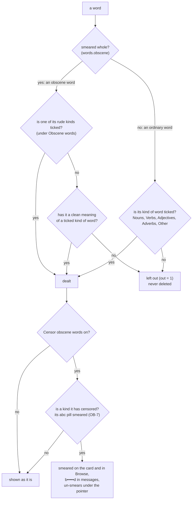

- **Order**: "Most common first" (by frequency rank) or "Mostly common, a little shuffled" (the default; its
  shape, spread and seed set how far it reaches). Compound words come later (`pen`).
- **Which words**: a tick box per kind of word, with counts; all start ticked but "Obscene words". Its kinds of
  rude meaning: Clinical, Crude, Swear words and Insults start ticked, Sexual and Slurs do not.
- **Censoring** smears Crude, Swear word, Sexual and Slur meanings to start with. Every kind has a small "abc" pill
  beside it, smeared while it is censored; Clinical and Insult start plain (OB-8). A word with several kinds stays
  smeared while any of them is censored. "Obscene words" (dealing) is scored from the four alone; the rules also
  read each word counting Clinical and Insult (`score_saved(also=...)`), kept in `words.smear_extra` (its kinds when
  that smears it whole, partial index `idx_words_extra`), so turning those on smears "penis" or "idiot" without
  moving them out of their kind of word. In a word that is not smeared whole, only its rude meanings are smeared, in the
  definitions, and only meanings of a censored kind (`rudeness.results` keeps each one's kind). The pills are saved
  in meta `censor_kinds` (`Store.censor_kinds`; `Store.censored_words` lists the words they smear). The card names
  a word's kinds faintly above it ("noun · sexual") either way. Turning censoring on says it may not be fully
  accurate (in full once a save, then a short message). Exports keep the real words.

#### What counts as rude

Decided by rules, not a list (`src/rudeness.py`, OB-6). Bump `rudeness.RUDENESS_VERSION` when a rule changes, and
measure with `tools/measure_rudeness.py` (79% the same outcome as an earlier sorting by Claude, 81% for the
commonest words).

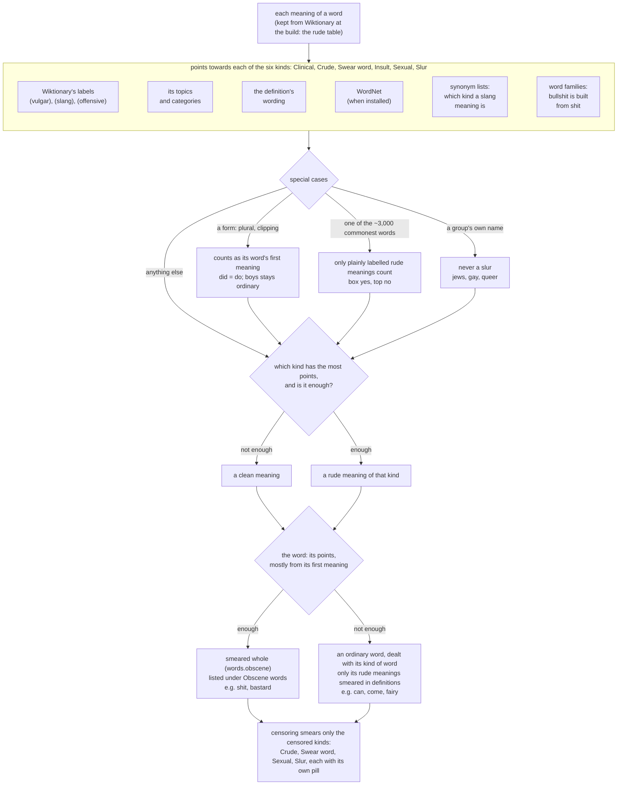

The smaller rules, each with the example that made it:

| Rule | Example |
|---|---|
| Clinical counts only when the word is about it | "penis", not "take" |
| A hedged label never smears a word whole | "what the hell" is only mildly vulgar |
| A hyphenated word with a rude part makes its slang meanings as rude | "piss-taker"; "doo-wop" has no slang meaning |
| Words a definition only gives as examples do not count | "such as slime or semen" |
| In a word smeared whole, a meaning naming the word itself is smeared too | "an instance of skull-fucking" |
| "Derogatory" alone is not an insult unless the definition describes a person badly | |
| A euphemism is the polite word | "pass water" |
| A slang meaning that is itself a rude word is rude like it | "dam: Damn." |
| A slur or rude meaning that is not the word's usual one smears that meaning only | "fairy" |

The Wiktionary build keeps the meanings the rules read (about 150,000 words of a million, the `rude` table) and
scores them once at the end of setting up. An older save, or one made from a word list, reads them from the
Wiktionary download in the background while you sort (`App._start_rude_read`); until then `src/obscene.py`'s short
hand-picked list stands in.

### Building a program

`python tools/build.py` turns the source into a program for the system it runs on (`dist/word-tierlister` on
Linux, `dist/word-tierlister.exe` on Windows, `dist/Word Tierlister.app` on macOS; about 25 MB). It installs
PyInstaller first if it is missing. Add `--check` to start the new program for a moment afterwards. The program
keeps its save next to itself (or in your user data folder when that folder is read-only) and finds the save you
used from source, so switching loses nothing. PyInstaller cannot build for another system: build on each one,
or on GitHub:

- `python tools/build.py --all` builds for Linux, Windows and macOS at once on GitHub's machines (the "Build
  programs" workflow, `.github/workflows/build.yml`, also on the Actions tab's Run workflow button), waits, and
  fetches `word-tierlister-linux`, `word-tierlister-windows.exe` and `word-tierlister-macos.zip` into `dist/`. It needs your commits pushed and GitHub's
  command-line tool logged in (`gh auth login`); without them it says what is missing and builds for this
  computer only. GitHub only starts the workflow once it is on the repository's default branch.
- **Publishing a release** (what the README's download links point to): set `VERSION` in `src/constants.py` and get
  it onto `main`, then on GitHub open Actions > Build programs > **Run workflow**, tick **Publish as a release** and
  run it (it makes the tag `v<VERSION>` itself); or tag and push it: `git tag v1.0.0 && git push origin v1.0.0`. The same workflow builds the three programs,
  starts each once to check it runs, and attaches them to a new release, whose page starts with
  `.github/release-notes.md`. (The macOS one is for Apple Silicon; it is not signed either.)

### Windows notes

- Run with `python tierlist.py`, or double-click it (or `pythonw tierlist.py`). The black console window closes
  by itself a moment after the program starts: it starts itself again with `pythonw.exe` (Python with no
  console window) and the first copy ends, so a double-clicked console closes and a terminal gets its prompt
  back. No `.pyw` file is needed, so the same source runs on Linux and macOS unchanged. Messages that would have
  been printed there go to `tierlist.log` next to your save file. If you want the console back for
  troubleshooting, run `python tierlist.py --console`.
- If something goes wrong, a dialog explains it in plain words (with Show details / Copy details) and the technical trace is added to `tierlist.log`. Your progress is saved after every action, so the program keeps running after most errors.

To see the friendly error dialog on purpose, start with `python tierlist.py --crash-test`: three
seconds after start it raises a fake bug. The dialog appears and the program keeps running.

### Running it on Linux / macOS

- Started from a terminal, the program opens its window and gives the terminal its prompt back: you can
  close the terminal, and the program keeps running. Its messages go to `tierlist.log` next to your save
  (`--console` keeps the terminal attached and prints there). If the window cannot open (no desktop), it
  stays in the terminal and says why.
- **Add to applications menu** (Linux; in File > Source & Updates, in the program, until it is there) puts Word
  Tierlister in your desktop's applications menu, so it starts with no terminal at all. Making the program from
  source has a tick, on to start with, that does the same for the new program; if Word Tierlister is in the menu already, the menu
  moves over to the new program by itself. On Windows it is **Add to Start menu**: a shortcut in your own Start menu (no administrator needed), which starts it
  with no console window and shows its icon (`deps.add_to_start_menu`, made by Windows' own PowerShell).
- The taskbar shows the program's icon: on Linux every start keeps a launcher for it
  (`~/.local/share/applications/word-tierlister.desktop`, out of the menu until you add it), which is how desktops
  such as GNOME know a window's icon.

### Updating, making a program, getting the source back

File > Source & Updates (`src/sources.py`; the work is in `src/standalone.py`) is one panel. What it offers
depends on which form is running:

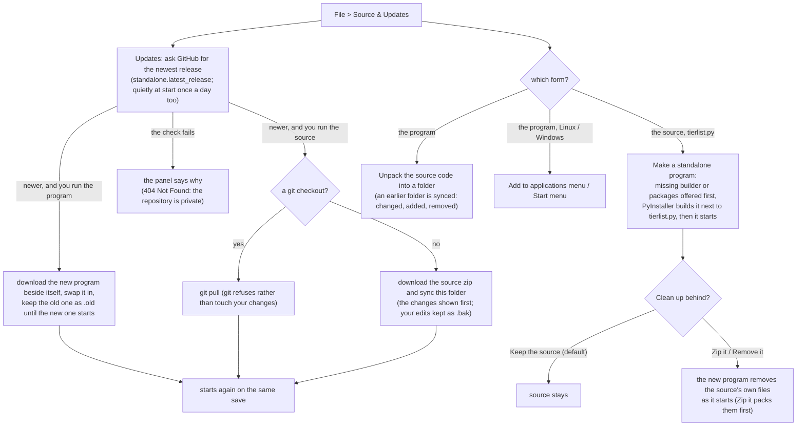

- The update tick (**Update to the newest version first**, on by default) makes the program from, or unpacks,
  the newest release's source instead of this one; offline or already the newest, it uses what you have.
- Each form offers the other once on its first start (`tierlist.py`: "Make this a standalone program?"; the
  program unpacks its source beside itself unless a copy is there). Not with `--no-install`.
- Cleaning up behind removes only the source's own files as they came (`standalone.removable`, F-47): in a git
  checkout the files git tracks with no uncommitted change; in an unpacked folder those unchanged since the unpack;
  otherwise the source's files (`source_files`; at the top only `TOP_FILES`, so an export or a file of yours stays:
  a new file at the top must be added there, `_selftest_folders` checks it against git's list).
  The window writes them down with their contents (`mark_for_removal`) and the new program removes a file only if it
  is still the same. A new build is copied in beside the old program and swapped in (`install_program`), so a failed
  copy never leaves none or half of one.
- Unpacking and updating only ever touch the program's own files (never a save, its log or a `.venv`); downloads go
  into temporary folders that are removed afterwards. Starting one form closes the
  other, so only one uses the save at a time, with a clean environment (`standalone.clean_env`: never the built
  program's Tcl / Tk folders).
- Packages the program never uses (matplotlib, Pillow, numpy and the like) are always left out of the build.
- Updating needs the repository to stay public: GitHub answers a private one's releases with 404.

### Syncing between devices

File > Sync with other devices (`src/syncdialog.py`) keeps the list the same on several computers through
[Syncthing](https://syncthing.net/), which copies one folder straight between your own devices (no account, no cloud).

- Each device writes one file of its own into the sync folder (`src/syncfiles.py`: `<computer>-<save>.wtsync`, gzip
  JSON), so no two devices ever write the same file and Syncthing never has a conflict to settle. A device never
  reads back its own computer's files.
- Every change to a word's tier, rating, games or skips is stamped with its time (`words.changed`, kept by
  triggers in `store.SYNC_TRIGGERS`). Reading another device's file (`Store.apply_sync`) keeps the newer change of
  each word; the anchors follow the newer anchors as a whole; each device's duels are kept apart
  (`comparisons.origin`). The later change wins by each device's clock.
- `AutoSync` looks at the folder every 10 s and writes this device's file at most once a minute while things keep
  changing, and once more on closing. Files are read on a worker thread and folded in 1,000 words a step, so a
  first sync of a million words never freezes the window; later rounds read only what changed since (`sync_marks`).
  Nothing syncs while `App.busy` (a reshuffle).
- Only an answer from another device counts as synced (SY-2): its file read here, or Syncthing reporting that a
  connected linked device has everything this one wrote (`Client.up_to_date`: `/rest/db/completion` at 100% once
  the folder is idle; `AutoSync.confirm`). Until then the window says "Never synced yet."
- `src/syncthing_api.py` finds Syncthing, starts it (and at log-in once the user agrees: systemd, an autostart
  file, a Startup shortcut or a LaunchAgent), and uses its local REST API to share the folder and link devices.
  Syncthing is an unticked option in the install window, and the sync window offers to install it first when it is
  missing.
- Tests never start the real Syncthing: `tests/_selftest_sync.py` talks to a pretend one. Test the sync window shown,
  never built and kept hidden: on macOS Tk then never runs out of events.

### Missing packages

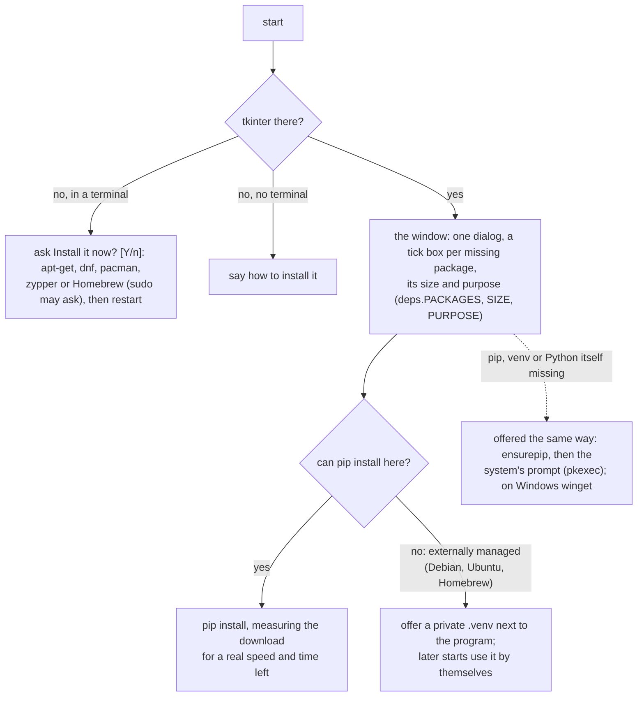

`wordfreq` is required (about 70 MB: it ranks the words); `nltk` is optional (about 35 MB with its data:
offline definitions and the WordNet list). An optional package left unticked is not offered again. Git is never
needed. `--no-install` turns all of it off.

### The log

`tierlist.log` sits next to your save. It keeps everything that goes wrong: errors (with a friendly dialog as well),
a window that stops answering for 10 seconds (and where the program was stuck), a hard crash, and a session that
ended without closing. Each start is marked with the version and the system it runs on. Send it along with a report.

