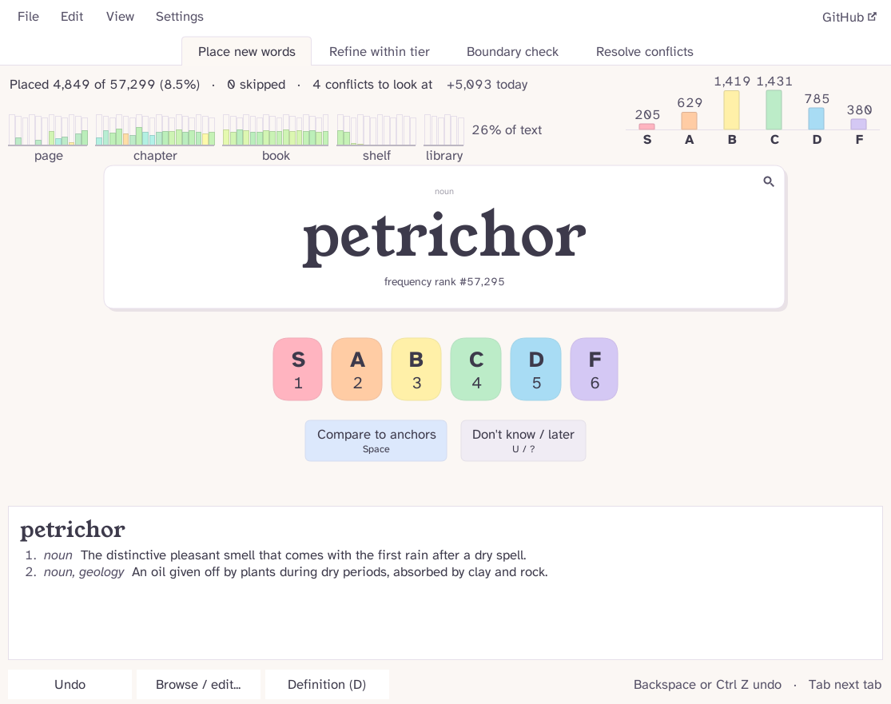
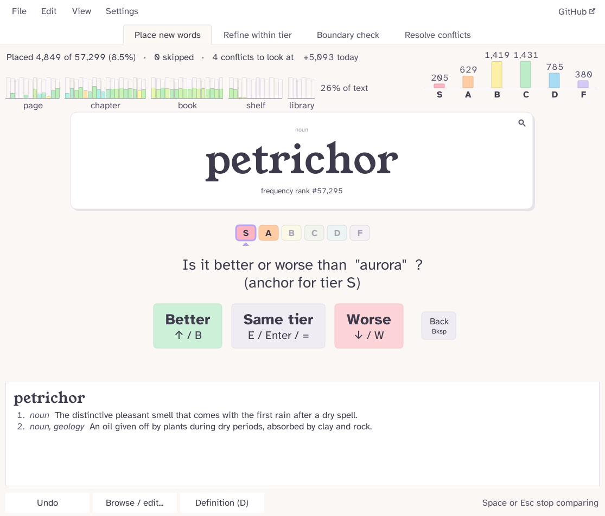
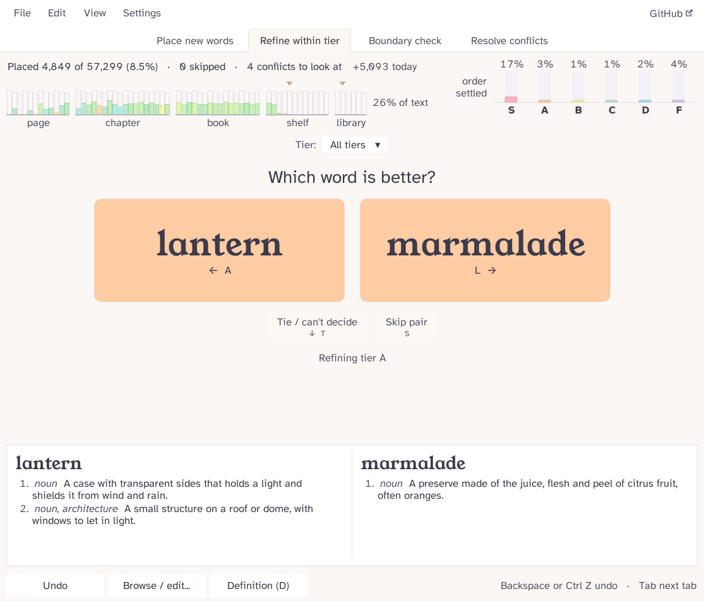
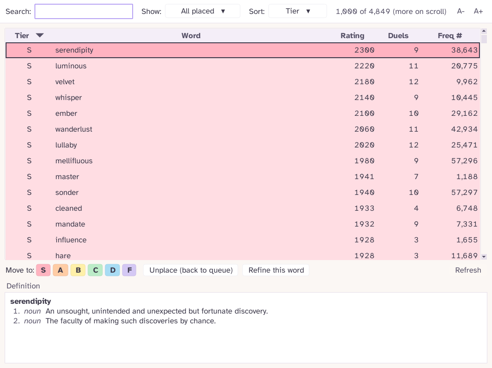
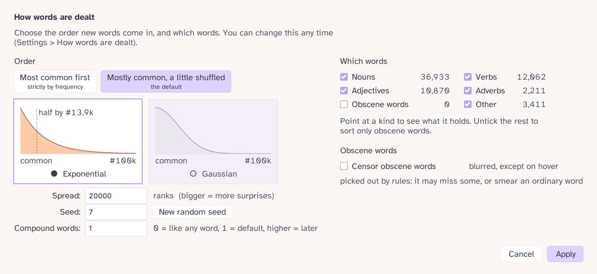
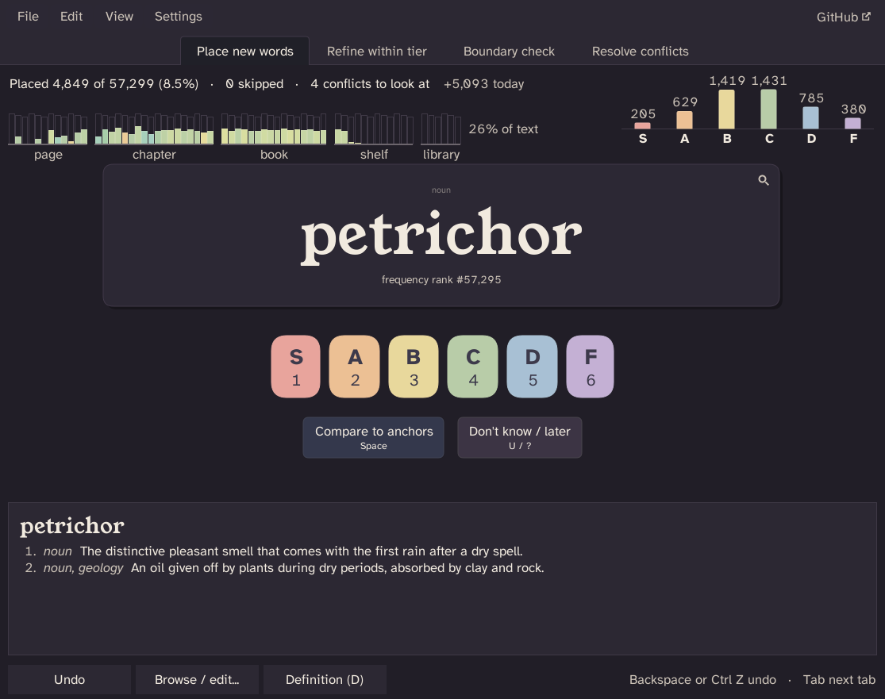
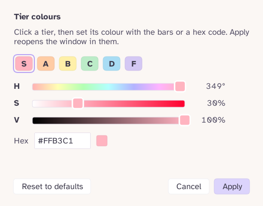
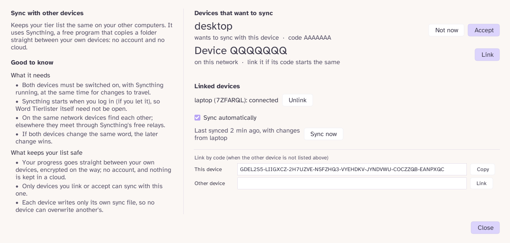
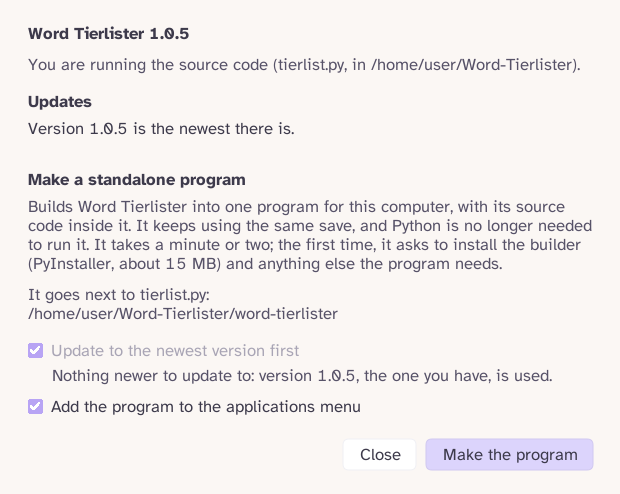

# Word Tierlister

**Rank every word in the English language, from S to F.** One word at a time, at your own pace, with your
progress saved after every single click.

  

Word Tierlister deals you words, about a million of them from English Wiktionary, the commonest first. You give
each one a tier. Later you can pit words against each other to put each tier in order. Close it whenever you
like: it carries on exactly where you left off, even after an update.

## Download

| | |
|---|---|
| **Windows** | [word-tierlister-windows.exe](https://github.com/kiva-mccr/Word-Tierlister/releases/latest/download/word-tierlister-windows.exe) |
| **Linux** | [word-tierlister-linux](https://github.com/kiva-mccr/Word-Tierlister/releases/latest/download/word-tierlister-linux) |
| **macOS** (Apple Silicon) | [word-tierlister-macos.zip](https://github.com/kiva-mccr/Word-Tierlister/releases/latest/download/word-tierlister-macos.zip) |

> **macOS is not tested yet.** The Mac version has only been run by automated tests on GitHub's Mac machines,
> never on a real Mac. It may have rough edges; please [report anything that goes wrong](https://github.com/kiva-mccr/Word-Tierlister/issues).

No Python needed. [All releases](https://github.com/kiva-mccr/Word-Tierlister/releases) are on GitHub.

1. **Put it in a folder of its own.** It keeps your save file right beside itself.
2. **Start it.** The programs are not signed, so your computer may hesitate the first time:
   - *Windows* may say it does not know the program: click **More info**, then **Run anyway**.
   - *Linux*: make it runnable first, with `chmod +x word-tierlister-linux` (or tick "Allow executing" in its
     file properties).
   - *macOS*: unzip it and open it. The first time, go to **System Settings > Privacy & Security** and click
     **Open Anyway**.
3. **Set how words are offered**: which kinds of words you want, and in what order (you can change this any time).

The very first start downloads English Wiktionary (about 3 GB) to build the word list. It shows how far along it
is and how long is left, and if the download is cut off it picks up where it stopped next time. After that it
works offline; only the online definitions need the internet.

> Would you rather run the Python source? Just run `python tierlist.py`: on the first start it offers to install
> anything that is missing. The [developer guide](DEVELOPERS.md) has the rest.

## Placing words

A word comes up on its card. Press a number key, **1** to **6** for S to F, or click a tier. That's it: the next
word slides in.

Can't decide? Press **Space** to **compare it to anchors**, one example word per tier. You answer "better",
"worse" or "same tier" about three times and the word lands in the right place.

  

- Not sure at all? **U** (or **?**) puts the word off for later. Skipped words come back once every fresh word
  has had its turn.
- Want to rank a particular word right now? Click the **magnifier** on the card (or press **/**) and type it.
- **D** opens the definition. Any word inside a definition can be clicked to look that one up too, and each
  definition links to its Wiktionary page.
- Made a mistake? **Backspace** or **Ctrl+Z** undoes it. Undo even works after you close and reopen the program.

## Putting each tier in order

Once a tier holds a few words, more tabs appear along the top. Each only shows up when it has something to do.

  

- **Refine within tier**: two words from the same tier, side by side. Pick the better one with **←** or **→**
  (a tie is **↓**, skip is **S**). Each answer nudges their scores, so over time every tier sorts itself.
- **Boundary check**: the weakest word of one tier against the strongest of the tier below. If the lower one
  wins, they swap tiers.
- **Resolve conflicts**: if your answers ever go in a circle (A beat B, B beat C, but C beat A), the pair waits
  here for you to judge again.

**Tab** moves to the next tab.

## Seeing your progress

The top of the window keeps score without nagging you:

- **The bookshelf**: a row of book spines, from the commonest words on the left to the rarest on the right
  (grouped as a page, a chapter, a book, a shelf and a library). Each spine fills up as you place its words, and
  takes the colour of the tier its words mostly went into. Point at a spine to see what is in it.
- **"41% of text"** after it says how much of everyday English the words you have placed would cover. The common
  words count for a lot, so this climbs fast.
- **The tier chart** at the top right shows how many words are in each tier. In Refine it shows how settled each
  tier's order is instead.
- The status line counts what you have placed, skipped, and placed today. Point at "today" for your pace per hour.

## Browse and edit your list

**Browse / edit...** at the bottom opens your whole list. Search it, show one tier (or the words you have not
placed yet), sort by any column, and move words to another tier or back into the queue.

  

The list loads as you scroll, so it stays quick even with a million words. **Delete** unplaces the selected word,
and Ctrl+Z brings it back.

## Choose which words you get

**Settings > How words are dealt** decides the order words come in and which kinds you want:

  

- **Order**: strictly the most common first, or (the default) mostly common with a little shuffle, so a rarer
  word turns up now and then. The curve shows how far the shuffle reaches.
- **Which words**: nouns, verbs, adjectives, adverbs and the rest, each with a tick box and a count. Untick a kind
  and those words wait out of sight; nothing is ever deleted.
- **Obscene words** start unticked. Tick them and you can choose which kinds of rude meaning you want (crude,
  swear words, insults, sexual, slurs, clinical).
- **Censor obscene words** smears a rude word sideways until you point at it, on the card, in Browse and in the
  definitions. A word that is only rude in one of its meanings (like "can") keeps its word, and only that meaning
  is smeared. A small "abc" button beside each kind of rude meaning lets you censor that kind or let it
  through on its own: crude, swear words, sexual and slurs are censored to start with, clinical and insults are not
  (click their button to smear words like "penis" or "idiot" too). Rude words are picked out by rules rather than a hand-made list, so now and then one slips through
  or an innocent word gets smeared. Exports always keep the real words.

## Make it yours

  
  

- **View > Dark mode** switches to Dusk, a warm dark look. The window changes in place.
- **Settings > Tier colours** lets you pick each tier's colour with hue, saturation and value bars, or type a hex
  code. It warns you if a colour would make the tier's letter hard to read.
- **Settings > Keyboard shortcuts**: every key can be changed. Click an action, press the new key.
- **View > Zoom** (or **Ctrl +** / **Ctrl -** / **Ctrl 0**) makes everything bigger or smaller. Make the window
  bigger and its contents grow with it. The maximized window remembers a zoom of its own.
- **View > Reduce motion** turns the animations down.
- **Settings > Anchor words** chooses the example word for each tier used when comparing.

## Keys

All of these can be changed under Settings > Keyboard shortcuts.

| Where | Key | What it does |
|---|---|---|
| Everywhere | **Backspace** or **Ctrl+Z** | Undo |
| | **D** | Show or hide the definition |
| | **Tab** / **Shift+Tab** | Next / previous tab |
| | **Ctrl +** / **Ctrl -** / **Ctrl 0** | Zoom in / out / actual size |
| Placing | **1** to **6** | Place in S, A, B, C, D or F |
| | **Space** | Compare to anchors |
| | **U** or **?** | Don't know, later |
| | **/** | Look up a word to sort it now |
| Comparing | **↑** or **B** | Better |
| | **E**, **Enter** or **=** | Same tier |
| | **↓** or **W** | Worse |
| | **Backspace** | Back one answer |
| | **Space** or **Esc** | Stop comparing |
| Duels | **←** or **A** / **→** or **L** | Left wins / right wins |
| | **↓** or **T** | Tie |
| | **S** | Skip the pair |
| Browse | **Delete** | Unplace the selected word |

## Your save is safe

- Everything is saved the moment you do it. Close the window, lose power, it doesn't matter.
- The save is one file, `tierlist.db`, next to the program (or next to `tierlist.py`). If that folder is
  read-only, it goes in your user data folder instead. **File > Where is my save file?** tells you where it is, and
  **Show in folder** opens that folder in Explorer, Finder or your file manager with the file picked out.
- Replace the program with a newer one, or move between the program and the Python source, and it finds your
  save again by itself.
- **File > Export tier list** writes your list as a spreadsheet (`.csv`), text or Markdown. **File > Import earlier
  progress** merges another save or an exported list back in. In the spreadsheet a word that starts like a formula
  (`-ness`, `=...`) has a `'` in front, so the spreadsheet shows it as text.

## Syncing between devices

  

**File > Sync with other devices** keeps your tier list the same on your other computers. It uses
[Syncthing](https://syncthing.net/), a free program that copies a folder straight between your own devices: no
account and no cloud. If Syncthing is missing, the window offers to install it first.

- Open the window on both devices. Each one shows up on the other under "Devices that want to sync": press
  **Accept**. If it does not show up, copy one device's code into the other at the bottom (**Link by code**).
- Syncing then happens by itself while the program runs (untick **Sync automatically** to only sync with **Sync
  now**).
- Both devices must be switched on, with Syncthing running, at the same time. If both changed the same word, the
  later change wins.

## Updates

**File > Source & Updates** asks GitHub whether a newer version is out. If there is one, **Update** downloads it,
swaps it in and starts again on the same save. It also checks quietly once a day when it starts, and mentions a
new version once.

  

The same panel can turn the Python source into a standalone program for your computer, or, in the program, unpack
its source code again (it carries it inside). On Linux and Windows it can also add Word Tierlister to your
applications menu or Start menu.

## If something goes wrong

A friendly message explains it in plain words, and the program usually keeps going. The details go into
`tierlist.log`, next to your save: please send it along with a report on
[GitHub](https://github.com/kiva-mccr/Word-Tierlister/issues).

## For developers

The [developer guide](DEVELOPERS.md) has diagrams of how the code fits together, a map of every file, the
command-line options, how to run the tests, and how builds and releases work.

## Licence

Word Tierlister is free software under the GNU General Public License, version 3 ([`LICENSE`](LICENSE)). The two
typefaces it ships with, Young Serif and Atkinson Hyperlegible, are under the SIL Open Font Licence 1.1.
